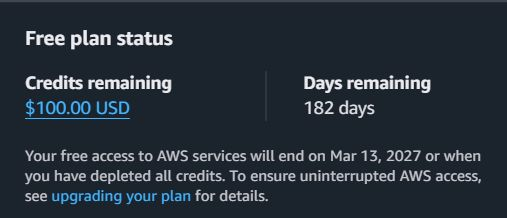
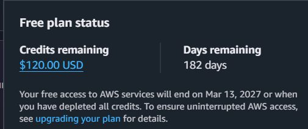
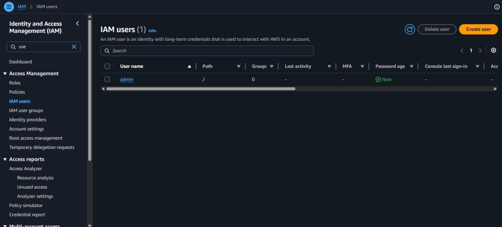
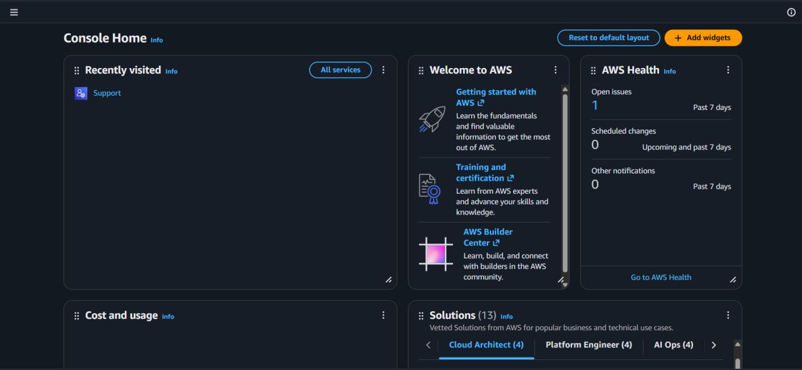
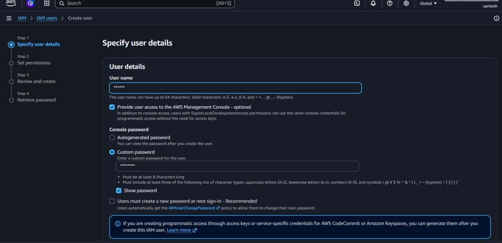

# AWS Lab: IAM User Creation and Root User MFA

## 🎯 Objective
Understand identity and access control in AWS by creating an IAM user
and securing the root account with MFA.

## 🧰 Services Used
- AWS IAM (Identity and Access Management)
- AWS Free Plan account

## 📝 What This Lab Is About
IAM controls who can access your AWS account and what they can do.
In this lab I set up my free AWS account, secured the root user, and
created my first IAM user for daily work.

## 🪜 Steps I Followed
1. Signed up for an AWS Free Plan account
2. Enabled **MFA** on the root user
3. Opened the IAM service and clicked **Create user**
4. Explored the available permission policies
5. Attached the `AdministratorAccess` policy to the practice user
6. Created the user and reviewed the summary

## 📸 Screenshots

## 🔑 Root User vs IAM User

| | Root User | IAM User |
|---|---|---|
| Created | When you first sign up | Created by you under the account |
| Access | Unrestricted, including billing and account settings | Only what you assign |
| Daily use | Avoid | Recommended |
| Protection | Must have MFA | Give least privilege |

## 💡 What I Learned
- Root = full account control. Keep it locked away and protected with MFA
- IAM user = day-to-day working identity with controlled access
- I used `AdministratorAccess` because this is a personal learning account.
  In production, this is not best practice. Always follow the
  **principle of least privilege** and grant only the permissions needed
- Completing AWS's guided setup tasks earned $20 extra credits on top
  of the $100 signup credit

## 🏢 In a Real Company I Would
- Create an IAM **group** (e.g. Developers) and attach policies to the group
- Give only the exact permissions needed (least privilege)
- Enforce MFA for every IAM user
- Never use root except for rare account-level tasks

## ⚠️ Security Notes
- Root user is protected with MFA
- No access keys were created or shared
- Account ID and sensitive details are hidden in screenshots

## 🔗 Links
- LinkedIn post: (https://www.linkedin.com/feed/update/urn:li:activity:7504940206526001152/)
